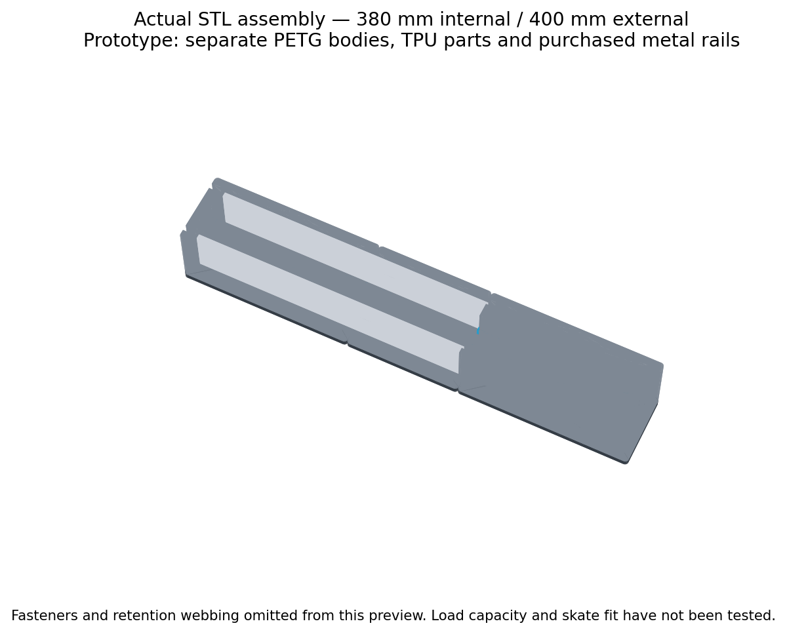
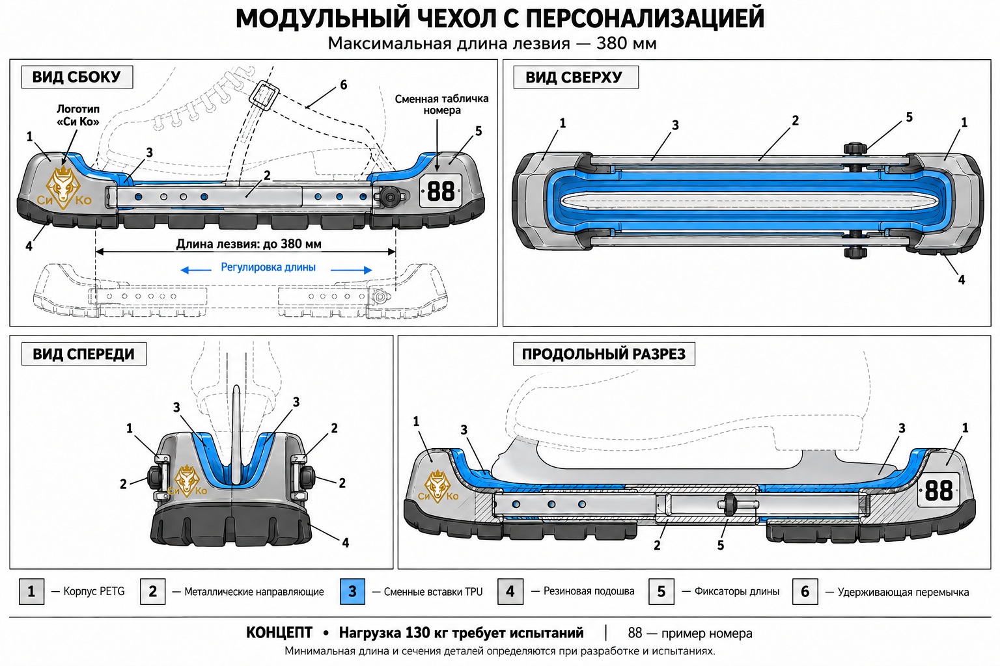

# Раздвижные чехлы для лезвий коньков «Си Ко»

Концепция чехлов для ходьбы, предназначенных для последующей разработки, 3D-печати прототипов и испытаний перед продажей.

## STL под Ender 3 Pro

[Скачать один STL с тремя деталями корпуса на 380 мм](stl/body_plate_380.stl) · [Архив всех STL и инструкции](releases/skate-guard-prototype-ender3pro.zip) · [Инструкция печати и сборки](PRINTING.md)

Разработан параметрический прототип v0.1. Раскладка корпуса имеет размер **150 × 200 × 36 мм**, с каймой 5 мм занимает около 160 × 210 мм. Все файлы STL используют миллиметры. Для первых проб печатайте детали по отдельности.

**В этой версии длина меняется заменой средней секции и пары цельных металлических направляющих. Телескопическое соединение из эскиза ещё не реализовано.** Печатный корпус состоит из трёх частей; максимальная сборка имеет наружную длину 400 мм и внутреннюю 380 мм.

- Корпус и накладки: PETG, сопло 0,4 мм, слой 0,2 мм; начальный профиль в инструкции.
- Вставки с пробными фиксаторами и подошвы: TPU 95A; отдельно от корпуса.
- Металлические полосы и крепёж необходимо изготовить/купить. Их нельзя заменять печатными деталями.
- Сначала проверить [образец посадок](stl/fit_coupon.stl) и [короткую вставку](stl/liner40.stl).
- [Исходник OpenSCAD](cad/skate_guard.scad) позволяет изменить номер и канал под измеренную толщину лезвия.



Сетка проверена на замкнутость, ориентацию граней, связность, контрольные суммы и габариты стола с каймой 5 мм: [отчёт](stl/validation.json). Эти проверки не подтверждают прочность, реальную печать, сцепление или посадку коньков. Слайсинг и физические испытания в облачной среде не выполнялись. Готового изделия для ходьбы или продажи пока нет.

## Предыдущий эскиз



[Предыдущий модульный эскиз](drawings/01-modular-guard-380mm.png)

## Требования пользователя

- Максимальная длина размещаемого лезвия: 380 мм. Внешняя длина чехла больше; она пока не определена.
- Регулировка длины для детских и взрослых коньков.
- Целевая совместимость: хоккейные, фигурные, детские и вратарские коньки. Совместимость со всеми моделями пока не подтверждена.
- Назначение: ходьба.
- Максимальная масса пользователя по заданию: 130 кг. Это требование, а не испытанная грузоподъёмность.
- Принтер: Ender 3 Pro, номинальная область печати около 220 × 220 × 250 мм; фактическую полезную область проверить.
- Изделие планируется продавать.
- Логотип «Си Ко» на передней секции; сменная табличка номера игрока на задней. Номер 88 на эскизе условный.

## Предложенная конструкция

Две печатные торцевые секции, металлические направляющие с перекрытием и защищёнными от выпадения фиксаторами длины. Сменные соединители позволяют расширять диапазон размеров. Минимальная длина пока не определена.

Сменные мягкие вставки адаптируют посадку к профилю и толщине лезвия. Для фигурных коньков требуется карман под зубцы. Предусмотрены широкая подошва с протектором, дренаж и эластичная удерживающая перемычка.

Логотип и табличка размещаются вне направляющих. Окончательное крепление декоративных элементов ещё не разработано.

## Материалы для прототипа

- PETG — опытные корпуса.
- TPU 95A — сменные вставки.
- Резина с проверенным сцеплением — подошва.
- Металлические направляющие и крепёж — марка, сечения и размеры выбираются после проектирования.

Материалы предложены для прототипирования; пригодность готовой конструкции должна быть подтверждена испытаниями. Настройки печати и ориентация деталей ещё не определены.

## Что ещё нужно разработать и проверить

1. Диапазон размеров и профилей реальных лезвий, включая детские модели; отдельно определить поддержку двухполозных коньков.
2. Размерная CAD-модель, допуски, размеры несущих элементов и непрерывная опора под кромкой лезвия.
3. Крепление подошвы, удерживающей перемычки и фиксаторов.
4. Стендовые испытания на статическую и повторную нагрузку, удар, боковой перекос, износ и удержание.
5. Проверка сцепления на мокрых покрытиях и поведения при низкой температуре.
6. Подтверждённые ограничения совместимости и нагрузки, инструкции для покупателей.

## Статус файлов

PNG — концептуальные иллюстрации, созданные генератором изображений. Они не являются согласованными производственными чертежами: геометрия и обозначения между видами могут различаться. Теперь добавлены параметрический исходник OpenSCAD и STL прототипа; STEP, расчётов и результатов физических испытаний пока нет. Фактическую геометрию прототипа следует оценивать по STL и исходнику, а не по прежним эскизам.

В локальном окружении доступны два сохранённых концептуальных эскиза и визуализация STL. Первый телескопический эскиз и отдельный исходный файл предоставленного пользователем логотипа отсутствуют; логотип виден в последнем эскизе. Проверить крайние размеры по каталогам производителей не удалось: сетевые запросы возвращали 403.

[История проектных решений](DESIGN-NOTES.md)

## Воспроизведение файлов

```sh
python scripts/export_stl.py
python -m venv /tmp/skate-guard-validation
/tmp/skate-guard-validation/bin/pip install -r scripts/requirements.txt
/tmp/skate-guard-validation/bin/python scripts/validate_stl.py
```

Для экспорта нужен OpenSCAD (проверено на 2021.01); для русского рельефа — шрифт DejaVu Sans Bold. Скрипт экспорта создаёт STL и обновляет контрольные суммы. Проверка сеток использует trimesh 4.9.0. Скрипт `render_preview.py` необязателен и дополнительно требует matplotlib.
